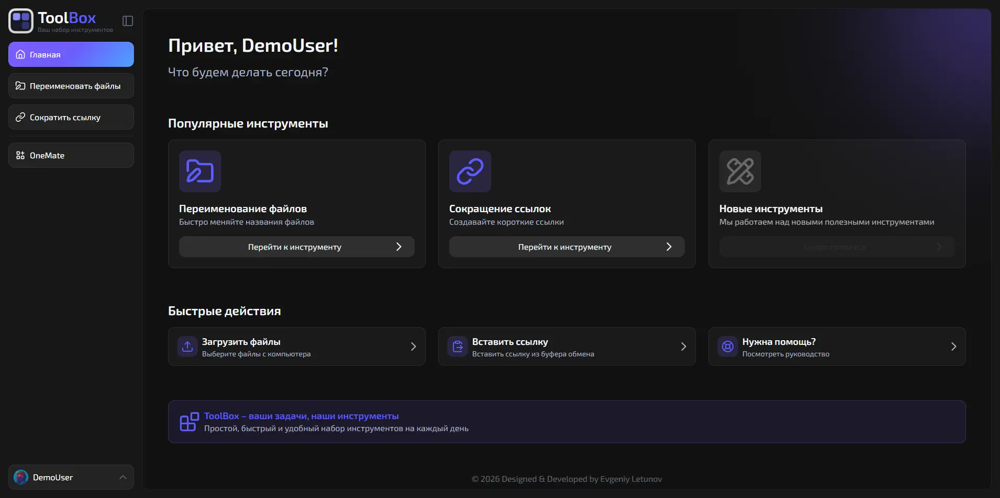
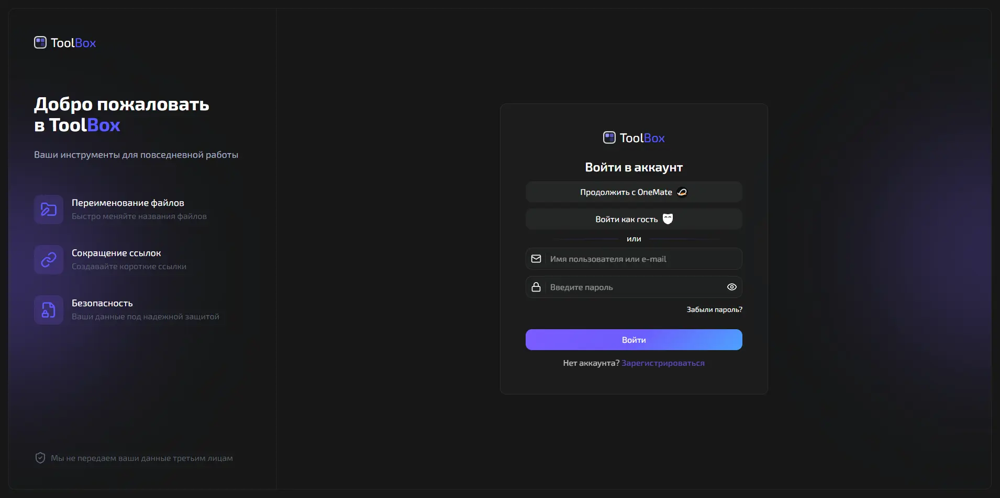
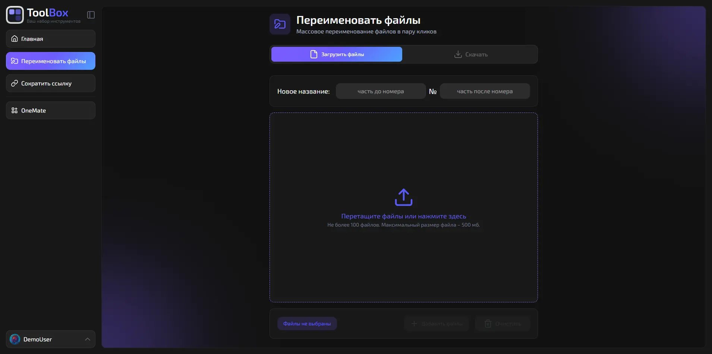
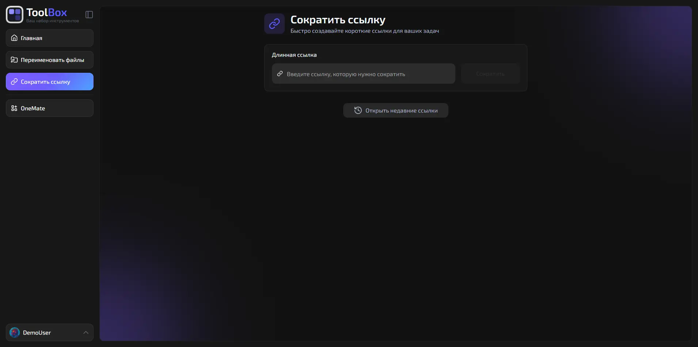

# ToolBox – твои инструменты в одном месте

**ToolBox** – веб-приложение, объединяющее специализированные инструменты для решения повседневных задач в едином рабочем пространстве.

  

  

## Модули

### Переименование файлов

**Пакетный переименователь** для массового изменения имён файлов по заданному шаблону с предварительным просмотром результатов.

- загрузка файлов через drag & drop или диалог выбора;
- настройка префикса, суффикса и порядковой нумерации;
- предварительный просмотр новых имён до скачивания;
- скачивание обработанных файлов одним ZIP-архивом.

### Сокращение ссылок

**Менеджер коротких ссылок** для создания, хранения и управления сокращёнными URL.

- сокращение исходных URL;
- просмотр и управление историей созданных ссылок;
- возможность быстро поделиться ссылкой или QR-кодом;
- открытие, удаление и закрепление ссылок;
- сохранение данных между сессиями.

## Технологический стек

### Frontend

- **React** и **TypeScript** – компонентная архитектура и строгая типизация;
- **FSD (Feature-Sliced Design)** – чёткое разделение ответственности и масштабируемая структура;
- **Tailwind CSS** – единый визуальный стиль и быстрая адаптивная вёрстка;
- **MobX** – реактивное управление состоянием с лаконичным синтаксисом;
- **Vite** – быстрый запуск и оптимизированная сборка.

### Backend

- **Laravel** и **Sanctum** – серверная бизнес-логика, REST API и сессионная аутентификация;
- **PostgreSQL** – реляционное хранение данных и управление связями между сущностями;
- **Laravel Queues** и **Scheduler** – асинхронное выполнение задач и автоматизация периодических процессов.

### DevOps & Infrastructure

- **Docker** и **Docker Compose** – контейнеризация приложений и унификация окружения;
- **Nginx** – reverse proxy и раздача приложений;
- **VPS** – деплой и администрирование проекта.

## Возможности

- **Авторизация** – регистрация, вход по email и через OneMate по OAuth 2.0;
- **Учётная запись** – управление профилем, смена пароля и восстановление доступа;
- **Связанные приложения** – привязка и отключение OneMate без потери доступа к аккаунту ToolBox;
- **Интерфейс** – адаптивная вёрстка для всех устройств, светлая и тёмная темы;
- **Локализация** – поддержка нескольких языков интерфейса;
- **Демо-режим** – знакомство с возможностями без регистрации.

## Скриншоты

  
Показать

  

    
    
    
  

## Автор

 
